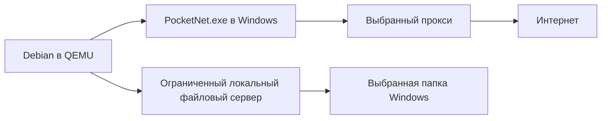

# Стек Pocket Linux

Переносимая папка Debian внутри Windows, без установки программ/драйверов/служб и без изменения сети основного ПК. Сетевой процесс работает в Windows вместо второй VM. Задачи и результаты этапов хранятся в корневом Beads; этот документ фиксирует технические решения.

## Требования к рабочему столу после проверки LXQt

Владелец 25.10.2026 отверг внешний вид и удобство LXQt. Новый ориентир — привычная работа как в Windows 11: цельные меню и настройки, читаемые подписи, панель закреплённых приложений, удобный файловый менеджер, русская раскладка и доступ к папкам Windows. Удобство важнее минимизации каждого мегабайта; размер архива и расход памяти измеряются на готовом образе.

Выбор исполнителя для отдельного кандидата — минимальный KDE Plasma 6 на X11, Dolphin и Konsole. Полные наборы KDE, офис, Akonadi, KDE Connect, второй браузер и сторонние расширения оболочки не нужны. Cinnamon сильнее зависит от OpenGL, Xfce требует больше ручного оформления. Предыдущий LXQt-комплект сохраняется отдельно.

QEMU в этой конфигурации не предоставляет гостю ускоренную 3D-графику. В KWin 6.3 отсутствует XRender: используются отключённый композитор и программный Qt Quick, а не обещание аппаратного ускорения. Индексирование файлов отключено, история общего буфера не сохраняется. Меню, поиск, изменение размеров окон и запуск приложений проверяются на настоящем образе; одной установленной темы недостаточно.

Требование владельца — отсутствие системного пароля Linux и дополнительных запросов хранилища ключей при обычном входе и работе. Изменения относятся к гостю; аккаунты Claude, пароли сайтов и защиту Windows они не отменяют. Существующие пользовательские ключи не сбрасываются: новый режим создаётся в чистой копии. Хранилище без пароля не шифрует сохранённые токены; доступ к папке виртуальной машины означает доступ к этим данным.

Claude Desktop запускается через локальный `/usr/local/bin/claude-desktop` с `--password-store=gnome-libsecret`: Electron должен использовать подготовленное хранилище Secret Service, а не автоматически выбирать отключённый KWallet в KDE. Официальный бинарный файл и его обновления остаются в `/usr/bin`; дополнительные аргументы передаются без изменения. Для проверки готовности хранилища явно установлен `libglib2.0-bin` с `gdbus`.

Основания: [Plasma в Debian 13](https://packages.debian.org/trixie/plasma-desktop), [KWin 6.3 для X11](https://sources.debian.org/src/kwin/4%3A6.3.6-1/src/compositor_x11.cpp/), [программный Qt Quick](https://doc.qt.io/qt-6.8/qtquick-visualcanvas-adaptations-software.html), [настройка Plasma](https://develop.kde.org/docs/plasma/scripting/api/), [GNOME Keyring](https://manpages.debian.org/trixie/gnome-keyring/gnome-keyring-daemon.1.en.html), [Electron safeStorage](https://www.electronjs.org/docs/latest/api/safe-storage).

Ниже сохранены решения и измерения раннего сетевого/LXQt-прототипа. Они не являются измерениями кандидата Plasma; актуальные результаты проверки находятся в Beads и соответствующем evidence.

## Выбранная основа

| Часть | Решение | Причина |
|---|---|---|
| Рабочая система | Debian stable amd64, минимальная установка, LXQt на X11 | Распространённая база, обычный рабочий стол и контролируемый состав |
| Виртуализация | Уже используемый переносимый QEMU 11.1.0 | Сохраняет существующую основу продукта |
| Ускорение | Уже доступный WHPX; ничего не включать автоматически | Нет установки компонентов на ПК пользователя |
| Диск | Самостоятельный QCOW2, без зависимости от дисков Pocket Windows | Перенос всей папки сохраняет систему и данные |
| Интерфейс | Существующая архитектура WPF/.NET Framework 4.8 | Общий UX двух продуктов, без независимого редизайна |
| Сеть | Отдельный процесс Windows: сетевой стек в пользовательском режиме и прокси-клиент | В рабочем Linux нет клиента прокси; в Windows нет нового сетевого адаптера |
| Сетевой вход | QEMU stream на loopback, Ethernet-кадры с длиной big-endian | Не требует TAP/Wintun и прав администратора |
| Прокси | Сначала SOCKS5; совместимость с Hysteria2, HTTP/HTTPS CONNECT — отдельное условие готовности продукта | Непроверенный транспорт не включается автоматически; HTTP CONNECT не обещает произвольный UDP |
| Файлы ПК | Существующий изолированный SMB-сервер Windows, CIFS mount в Linux | Одни файлы без обязательной второй копии и фоновой синхронизации |
| Окружение | Браузер, Claude Desktop, Claude Code, Git, Python, Node.js, базовые средства сборки | Пользователь получает настроенную систему; дополнительные SDK не входят автоматически |

Закреплены Go 1.27.3, `sagernet/gvisor v0.0.0-20260727.0-sing-box-mod.1` и `sagernet/sing v0.9.7-0.20260929150544-0ad23b637bd4`; версии зависимостей и суммы находятся в `src/netproxy/go.mod` и `go.sum`. Используется прокси-клиент из экосистемы sing-box, без полного `Box`: его инфраструктура содержит лишние для этой задачи маршрутизаторы и возможность direct-outbound. Собственный TCP/IP стек не разрабатывается. Причина выбора прямого API — меньше размер и меньше доступных путей выхода, при сохранении тех же сетевых библиотек.

Для изготовления рабочего образа: Debian 13 stable amd64, `lxqt-core`, X11, Openbox, SDDM, PCManFM-Qt и QTerminal; Firefox ESR; официальный Claude Desktop для Linux и нативный Claude Code; Git, Python 3.13 с venv, Node.js 24 LTS с npm, build-essential, pkg-config, curl, CA-сертификаты, cifs-utils. Python и Node нужны для проектов пользователя; нативный Claude Code сам по себе не требует отдельного Node. LXQt не меняется на другой рабочий стол при оптимизации. Полный live-ISO, офисный пакет, Docker, локальные модели и несколько IDE не входят в базовый состав. При сборке фиксируются конкретные версии, источники и SHA256; обновления выполняются как проверенное обновление продукта.

## Граница переносимости

Целевой пользовательский сценарий: распаковать папку и запустить Launcher, без Setup и установки зависимостей. Уже существующие возможности Windows не являются частью ZIP. WHPX требует включённого Windows Hypervisor Platform; на машине без него программа не имеет права устанавливать компонент. Полностью программный QEMU TCG проверен: Debian загрузился, прошёл 30 сетевых условий и штатно выключился без WHPX. Для используемого BIOS требуется `q35,smm=off`, поскольку диагностика обнаружила цикл внутри эмулируемого SMM. Это настройка гостя, не BIOS хоста. Загрузка до пробника на i5-11600: около 9 секунд с WHPX и 50 секунд с TCG; скорость полного LXQt и приложений ещё не измерена. Одинаковая производительность на любом Windows-ПК не обещается. Текущий комплект — стенд сети с консольным Debian, а не готовый Launcher с LXQt.

Компилятор и служебные загрузки находятся только в `_temp/2026-10-25-pocket-linux`, вне конечного комплекта. Установка пакетов при изготовлении гостевого образа выполняется внутри копии Linux, не в Windows пользователя.

## Контракт сети

У рабочего гостя нет прямого QEMU NAT в интернет. Все внешние TCP/UDP-соединения создаёт только сетевой процесс через явно выбранный прокси. Ошибка/отсутствие/падение прокси или сетевого процесса не открывает альтернативный маршрут. DNS также проходит через прокси; недопустимый или неподдерживаемый транспорт блокируется. IPv6 не получает прямого запасного пути. Секреты профиля не передаются в рабочий Linux.

Выбранные папки доступны только через отдельную ограниченную локальную сеть. Самостоятельный доступ гостя к другим портам Windows и физической LAN не разрешается. Сохранение обычного вида сети в Linux не означает гарантии нераспознаваемости внешнего IP как прокси.

Нативный процесс использует текущие маршруты Windows до выбранного прокси. Если на основном ПК уже работает VPN, он может оставаться дополнительным участком этого пути. Прототип не обходит и не перенастраивает VPN Windows; проверка локального прокси не измеряет задержку такого внешнего пути.

Первый стенд использует контролируемые прокси и конечные точки с журналом обращений. Он отделяет архитектурную проверку от проверки чужого коммерческого прокси и не использует личные секреты пользователя.

В проверенном прототипе адрес прокси — явно заданный IPv4. SOCKS UDP relay допускается только на том же IP; другой порт разрешён протоколом. Прокси с отдельным IP UDP relay будет отклонён. DNS-стенд передаёт запросы через SOCKS TCP к фиксированному тестовому DNS-серверу; готовый продукт должен использовать DNS-over-HTTPS через тот же прокси. Обычный системный DNS Windows не вызывается. Любые неподдержанные пакеты, включая IPv6 и ICMP, блокируются. UDP-сессии ограничены 20 секундами, TCP — 3 минутами: это ограничение стенда, непригодное для длительной разработки, и оно явно отмечено в коде.

Программы Linux видят обычный сетевой интерфейс и локальный адрес шлюза; прокси-паролей и переменных `HTTP_PROXY` в госте нет. Это не доказывает нераспознаваемость прокси: сервис видит IP выхода, приложения могут анализировать сетевое поведение, а администратор Windows контролирует всю среду. Поведение при сбоях проверяется, обещание «никто никак не определит» не даётся.

## Общая оболочка Windows и Linux

WPF-лаунчер и Python-управление сохраняются. В общей оболочке нужен параметр редакции/гостевой ОС, который выбирает образ, настройки памяти, гостевого помощника и сетевой backend. Внешние команды «запустить», «остановить», «состояние», «папки», «профиль сети» остаются одинаковыми. Платформенные команды Windows из гостевого помощника не переносятся в Linux вслепую: Linux получает небольшой отдельный помощник для настроек и монтирования папок.

В исходниках Pocket Windows затрагивались бы `scripts/launch_runtime.py`, сетевой план, проверка/упаковка компонентов и гостевые помощники; WPF меняется только при необходимости общей функции. Изменения общей оболочки применяются к обеим редакциям. Новый сетевой backend для Windows требует проверки её сценариев перед заменой действующего шлюза. В рамках этого прототипа исходники и принятая сборка Pocket Windows не изменялись.

## Файлы и повседневная работа

Выбранная папка Windows будет видна в файловом менеджере Linux как обычная папка. Сохранение изменяет исходный файл Windows, а не независимую копию. По умолчанию нет клиента двусторонней синхронизации и дублирования всех данных.

Например, выбранная `D:\Проекты\Demo` отображается как `/mnt/windows/Demo`. Путь доступен файловому менеджеру, браузеру, Python, Node и Claude Code. Изменение и удаление затрагивают оригинал в Windows. Основной диск Linux содержит систему, домашнюю папку, настройки приложений и Linux-зависимости. Для виртуального диска задаётся максимальная ёмкость, например 32 GB, но QCOW2 занимает место по фактически записанным данным. Перенос всей папки переносит систему; общие папки Windows заново выбираются на другом ПК.

SMB работает через уже существующий сервер проекта, привязанный к loopback, с временными учётными данными и доступом только к выбранным каталогам. Вторая виртуальная машина для файлов не нужна. Транспорт папок отделяется от выхода в интернет и не должен давать Linux доступ к остальным службам Windows. Отдельный живой CIFS-тест подтвердил чтение Windows-файла, UTF-8/кириллицу, запись, переименование, удаление собственного временного файла и видимость результата со стороны Windows. Он использовал штатный модуль ядра Debian, без установки пакетов на хосте или в этом госте. Эта проверка не равна полной совместимости любого приложения с SMB.

Совместный TCG-тест подтвердил оба канала в одной VM: 36/36 условий, включая файловые операции во время отключённого прокси. Основной интерфейс сохраняет единственный внешний маршрут; у файлового нет DNS/default route, а QEMU разрешает ему только адрес и порт локального SMB. Результат находится в `evidence/combined-tcg/result.json`.

Нужно отдельно проверить кириллицу, пробелы, переименование, удаление, безопасное сохранение редактором, одновременный доступ и уведомления об изменениях. Windows/SMB не равны локальной POSIX-файловой системе: Linux-права, ссылки и регистр имён отличаются. `.venv`, Linux-зависимости и сборочные кэши рекомендуется хранить внутри Linux; готовность конкретного проекта на общей папке подтверждается его реальным запуском.

## Размер: база и оценка

Прочитанный ZIP Pocket Windows 2026.10.24.13: 16.92 GB, из них диск Windows 16.05 GB, шлюз 708.6 MB, прочее около 169 MB (десятичные единицы). Это измерения существующего выпуска, не Pocket Linux.

Прежний прогноз 3–6 GB для загрузки и 8–15 GB после распаковки отозван как недостаточно обоснованный. Главный приоритет владельца — минимальный архив при сохранении Debian, LXQt и согласованных функций. Точный размер полного окружения пока не измерен; размер ISO установщика его не определяет.

25.10.2026 существующий консольный прототип действительно упакован в ZIP Deflate 9: **420 311 397 байт**, 1018 файлов, CRC всех файлов проверен, SHA256 `af51615762feb0fba027583c35b898e97f5ab3e60eff419e0e755bb1155ea222`. Отчёт `evidence/archive-size.json`. Сжатое содержимое: исходный Debian 337.43 MB, QEMU 64.05 MB, Windows Python 14.67 MB, сетевой процесс 2.97 MB, файловый сервер 0.86 MB. Это ещё без LXQt и пользовательских приложений; 573 MB — размер папки этого же стенда до ZIP, а не готового рабочего окружения.

Узкий состав «Debian + LXQt + Claude Desktop + его зависимости + переносимые средства запуска» имеет предварительный инженерный ориентир около 1 GB ZIP (грубо 0.8–1.2 GB), без обещания попадания в диапазон. Основание — 420 MB проверенной основы и официальный пакет Desktop около 170 MB, с запасом на графические библиотеки, LXQt и различия сжатия. Полный набор зависимостей ещё не разрешён и не установлен, поэтому это оценка, а не результат сборки. Firefox, Claude Code и дополнительные средства разработки сюда не включены; из согласованного полного продукта они не исключаются. Размеры сжатых пакетов нельзя механически считать вкладом в ZIP установленной системы.

Для компактной сборки берётся минимальный Debian и `lxqt-core` с явно выбранными необходимыми компонентами, без автоматического добавления всех рекомендуемых пакетов. В готовый образ не входят установочный ISO, скачанные пакеты, кэши сборки и вторая VM. Обязательные функции, библиотеки, сертификаты и лицензии сохраняются. Пользовательские проекты, зависимости, кэши и обновления растут отдельно.

Для разработки начальная проверка планируется с 4 GiB памяти рабочего Linux: Claude Code указывает 4 GB+ RAM для среды. Фактическое потребление всей пары QEMU+сетевой процесс на Windows и простои измеряются отдельно. Нет обещания комфортной разработки с браузером на 512 MB RAM.

Сетевой прототип измерен отдельно: EXE 7 460 864 байт; в тесте 12.5–16.5 MB резидентной памяти и 49.1–53.5 MB commit. Консольный Debian загружался с 1024 MiB выделенной памяти; это не измерение LXQt, браузера и инструментов разработки. Официальный индекс Claude Desktop на момент проверки содержит пакет 3.6556.2: 169 811 528 байт скачивания и Installed-Size 597 819 KiB (около 612 MB), без учёта общих зависимостей. Показатель Installed-Size не равен размеру QCOW2 или ZIP.

## Источники

- [Debian cloud images](https://cloud.debian.org/images/cloud/trixie/latest/) — исходный Debian для сетевого стенда; образ проверен по SHA512.
- [Состав lxqt-core](https://packages.debian.org/trixie/lxqt-core) — минимальная метагруппа рабочего стола; размер метапакета не является размером установки.
- [QEMU WHPX](https://www.qemu.org/docs/master/system/whpx.html) — требования аппаратного ускорения Windows.
- [gVisor](https://gvisor.dev/docs/) и [sing](https://github.com/SagerNet/sing) — сетевые библиотеки; используемые версии закреплены в исходниках.
- [Claude Desktop для Linux](https://support.claude.com/en/articles/10065433-install-claude-desktop) и [официальный индекс пакетов](https://downloads.claude.ai/claude-desktop/apt/stable/dists/stable/main/binary-amd64/Packages) — поддержка Debian и измерение пакета.
- [Claude Code](https://code.claude.com/docs/en/setup), [ветки Node.js](https://nodejs.org/en/about/previous-releases) — требования и выбор поддерживаемой LTS-ветки.
- [Linux CIFS](https://docs.kernel.org/admin-guide/cifs/usage.html) — монтирование SMB и отличия от локальной файловой системы.
